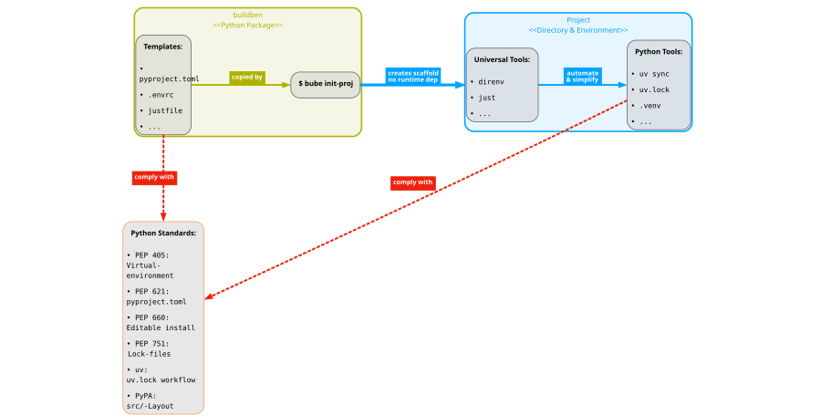
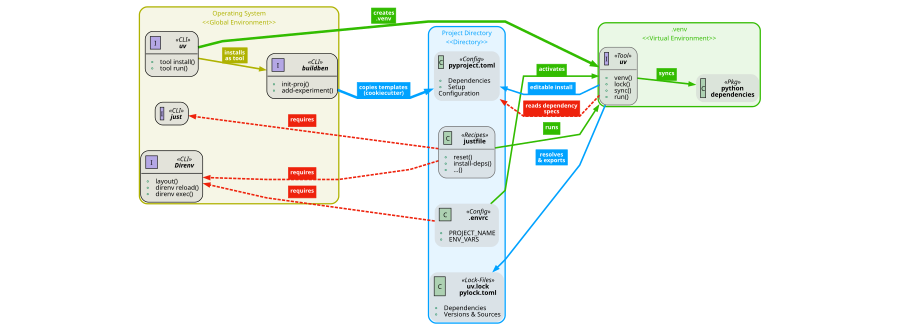
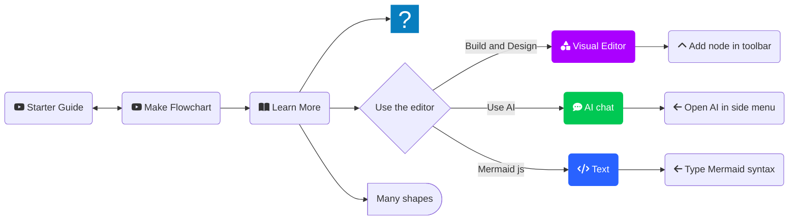
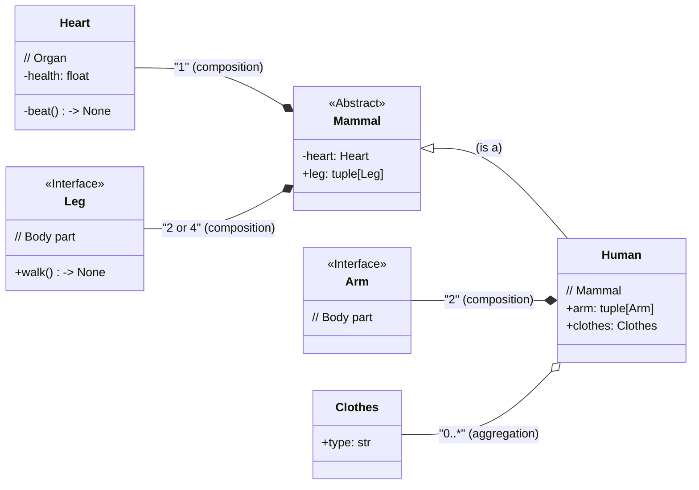

<!-- ============================================================== -->
<!-- == Header ==================================================== -->
<div align="center">

<!-- --- Title ---------------------------------------------------- -->

# `buildben`: build-benedictions

*Part of:*
<!-- --- Logo ----------------------------------------------------- -->
<a href="https://hisqu.de" target="_blank">
  
</a>

<br>

<!-- --- Badges --------------------------------------------------- -->

[](https://github.com/psf/black)

</div>

<!-- ============================================================== -->
<!-- == Abstract ================================================== -->
<div style="width: 85%; margin: 2rem auto; text-align: justify;">
<hr>

<blockquote> <i> A <b> benediction </b>(Latin: bene, 'well' + dicere, 'to speak') is a short invocation for divine help, blessing and guidance, usually at the end of worship service. </i> <sup> <a href="https://en.wikipedia.org/wiki/Benediction"> Wikipedia </a></sup> </blockquote>


#### `buildben` ...
<!-- Summarize the top 3 features -->
- ... = a Python development tool.
- ... standardizes project & experiment setups with template scaffolds
- ... integrates popular tools like `pipx`, `direnv`, `just`, etc.
- ... snapshots a project commit, lock file, and build artifacts for reproducible experiments


#### Main dependencies:
<!-- List your main dependencies here and explain why they're important. -->
- **[`uv`](https://github.com/astral-sh/uv)**: Awesome fast dependency manager & virtual environment tool, etc.
- **[`direnv`](https://direnv.net/)**: Auto-loads project-specific environment and provides  one-liners for environment management.
- **[`just`](https://github.com/casey/just)**: For running tasks to manage build tools & the virtual environment.

<!-- Dev dependencies: 
- **[`pipx`](https://pipx.pypa.io)**: The recommended home for `buildben`, making it accessible globally while keeping the OS-Python clean
- **Dependency groups:** Local dev tools live in `[dependency-groups]` and install with `python -m pip install -e "." --group dev`.
-->

<hr>
</div>
  


<!-- <div align="center">

  <p>
  <b> Graphical Abstract</b>: Buildben creates scaffolds for python projects adhering to Python PEP-standards.
  </p>
</div> -->


|  |
|:--:|
| **Fig. 1 - Graphical Abstract:** Buildben creates scaffolds for Python projects adhering to Python PEP standards. |

<br>


### Table of Contents

<!-- toc -->

1. [`buildben`: build-benedictions](#buildben-build-benedictions)
   1. [📦 Installation](#-installation)
      1. [Uninstall](#uninstall)
   2. [🚀 Usage](#-usage)
   3. [❓Optional Installs](#optional-installs)
   4. [📚  Examples / Documentation](#--examples--documentation)

<!-- tocstop -->
<!-- /toc -->

<br>

<!-- ============================================================== -->
<!-- == Installation ============================================== -->
## 📦 Installation

### Prerequisites:
- Python installed on your OS (and you know its executable in your `$PATH`)
- A Package manager (`apt`, `brew`, `winget`, etc.)

### 🏃Quick & Dirty:
```bash
git clone https://github.com/HisQu/buildben.git
cd buildben
python -m pip install -e "."    # venv recommended
```

### 🏗️ Full Install (recommended): 

<!-- 
#### 1. Install [`pipx`](https://pipx.pypa.io/stable/installation/):
To use `buildben`  globally and to keep the OS-python clean, we recommend `pipx`.
```bash
sudo apt install pipx        # For Ubuntu
# brew install pipx          # For MacOS
# py -m pip install --user pipx   # For Windows (Not tested!)
pipx ensurepath                   # Add pipx to PATH, if not already done
pipx upgrade-all                  # !! Never run pipx with sudo !!
```
-->
### One-line installation

The installer bootstraps from the current `main` branch in both modes. By
default it installs the latest stable release source distribution;
`--version X.Y.Z` selects a specific stable release. Release installs use the
published release artifact. `--main` instead installs one snapshot of the
current remote `main` branch, pinned to the commit resolved for that invocation
and its committed `uv.lock`; it does not use local checkout changes or require
a GitHub release or Actions artifact.

`--main` requires GitHub access. Public access uses anonymous GitHub requests;
authenticated access uses GitHub CLI as described below. Main may contain
unreleased code whose CI has not passed. The installed package version comes
from `pyproject.toml` and may match a release; the installer prints the source
commit SHA to identify the snapshot. Omit `--main`, or use `--version`, to
install a release again.

| Selection | Installer behavior |
| --- | --- |
| *(no source option)* | Install the latest published stable source archive. |
| `--version X.Y.Z` | Install the selected published stable release. |
| `--main` | Install one captured commit from remote `main` with its committed `uv.lock`. |


#### Linux & macOS

Latest stable release:

```sh
installer="$(curl -fsSL 'https://raw.githubusercontent.com/HisQu/buildben/main/src/buildben_dev/distribution/install-linux-macos.sh')" && test -n "$installer" && bash -c "$installer" --
```

Specific stable release: append `--version X.Y.Z` to the installer arguments.

Current remote `main` snapshot:

```sh
installer="$(curl -fsSL 'https://raw.githubusercontent.com/HisQu/buildben/main/src/buildben_dev/distribution/install-linux-macos.sh')" && test -n "$installer" && bash -c "$installer" -- --main
```

Authenticated latest stable release:

```sh
installer="$(gh api -H 'Accept: application/vnd.github.raw+json' 'repos/HisQu/buildben/contents/src/buildben_dev/distribution/install-linux-macos.sh')" && test -n "$installer" && bash -c "$installer" -- --github-client gh
```

Authenticated current remote `main` snapshot:

```sh
installer="$(gh api -H 'Accept: application/vnd.github.raw+json' 'repos/HisQu/buildben/contents/src/buildben_dev/distribution/install-linux-macos.sh')" && test -n "$installer" && bash -c "$installer" -- --github-client gh --main
```

#### Windows

Latest stable release:

```powershell
$s = Invoke-RestMethod -Uri 'https://raw.githubusercontent.com/HisQu/buildben/main/src/buildben_dev/distribution/install-windows.ps1'; if ([string]::IsNullOrWhiteSpace(($s -join "`n"))) { throw 'Could not download the installer.' }; & ([scriptblock]::Create(($s -join "`n")))
```

Specific stable release: append `'--version' 'X.Y.Z'` to the scriptblock invocation.

Current remote `main` snapshot:

```powershell
$s = Invoke-RestMethod -Uri 'https://raw.githubusercontent.com/HisQu/buildben/main/src/buildben_dev/distribution/install-windows.ps1'; if ([string]::IsNullOrWhiteSpace(($s -join "`n"))) { throw 'Could not download the installer.' }; & ([scriptblock]::Create(($s -join "`n"))) '--main'
```

Authenticated latest stable release:

```powershell
$s = gh api -H 'Accept: application/vnd.github.raw+json' 'repos/HisQu/buildben/contents/src/buildben_dev/distribution/install-windows.ps1'; if ($LASTEXITCODE -ne 0 -or [string]::IsNullOrWhiteSpace(($s -join "`n"))) { throw 'Could not download the installer.' }; & ([scriptblock]::Create(($s -join "`n"))) '--github-client' 'gh'
```

Authenticated current remote `main` snapshot:

```powershell
$s = gh api -H 'Accept: application/vnd.github.raw+json' 'repos/HisQu/buildben/contents/src/buildben_dev/distribution/install-windows.ps1'; if ($LASTEXITCODE -ne 0 -or [string]::IsNullOrWhiteSpace(($s -join "`n"))) { throw 'Could not download the installer.' }; & ([scriptblock]::Create(($s -join "`n"))) '--github-client' 'gh' '--main'
```

`--main` cannot be combined with `--version`. For authenticated access, install [GitHub CLI](https://cli.github.com/), then
run `gh auth login` and `gh auth setup-git`. Public downloads use anonymous
access; `curl` does not inherit gh credentials. Private VCS dependencies still
need Git authentication independently of release visibility. BuildBen and
generated applications do not require administrator privileges.

Windows installer verification covers both `.ps1` file execution and the
downloaded-text invocation above. Run the focused native Windows checks with
`uv run --locked python -m pytest -n 0 tests/test_release_install.py -k windows_installer`.
`just release-install-smoke` additionally checks real source installation and
saved uninstallation through both Windows entrypoints.

### Uninstall

New installer-based installations save an offline uninstaller outside the tool
environment. Run the native path printed by the installer, or use
`./uninstall.sh` / `.\uninstall.cmd` from this checkout to dispatch to it:

```sh
./uninstall.sh --dry-run
./uninstall.sh --yes
```

On Unix, support is saved under
`${XDG_STATE_HOME:-$HOME/.local/state}/buildben/installation`; `XDG_STATE_HOME`
must be absolute. On Windows it is under `%LOCALAPPDATA%\buildben\installation`;
`LOCALAPPDATA` is required. The saved launcher uses an absolute base Python
3.12+ interpreter, not Buildben's removable environment or Python from PATH.
Keep that interpreter available. The saved helper and private `receipt.json`
remain after removal for recovery and safe repeated invocation.
Its receipt stays bound to that saved directory even if a later shell changes
`XDG_STATE_HOME` or `LOCALAPPDATA`; it does not switch to another installation.

`--dry-run` previews without mutation or downloads. `--yes` confirms package
removal only; without a terminal it is required for mutation. Default removal
keeps user data, uv, shared Python, caches, and shell configuration. Buildben
does not use AppRC itself and rejects `--clean-appdata` and `--apprc-dir`.
Generated applications provide their own explicitly mounted `appdata` commands.

`--remove-uv` is a separate request, not an override of ownership checks. uv can
be removed only when this installer bootstrapped it, all recorded binary hashes
still match, and both the recorded and default uv tool inventories permit it.
Other projects may still use uv even when no tools remain; there is no global
idle detection or lock against concurrent uv commands. Removal unlinks only
recorded binaries, uv last; it never recursively removes uv directories.

For an older installation with no receipt, use
`./uninstall.sh --uv /absolute/path/to/uv --yes` (or the Windows equivalent).
This explicit recovery mode removes only the package and cannot clean data or
remove uv. A malformed receipt is retained for inspection. With a valid receipt,
`--uv` cannot select a different installation. If its saved interpreter is no
longer available, use `uv tool uninstall buildben` directly with the original
`UV_TOOL_DIR` and `UV_TOOL_BIN_DIR`. Older selected releases without lifecycle
support print this direct-removal diagnostic instead of claiming a receipt.

For an editable pip installation, use that environment's
`python -m pip uninstall buildben`; the uv lifecycle is not a pip requirement.


### Install from a cloned repository


#### 3. Install [`just`](https://github.com/casey/just):
```bash
sudo apt install just     # For Ubuntu
# brew install just       # For MacOS
# pipx install rust-just  # Windows requires the cross-platform version (not tested!)
```


#### 4. Install [`direnv`](https://direnv.net/) & hook it into your shell: 
   - *Either* follow the instructions for [install](https://direnv.net/docs/installation.html) & [hook](https://direnv.net/docs/hook.html),
   - *Or* run `src/buildben/setup_zsh.sh` to install both `zsh` & other useful plugins, including `direnv`.

```bash
# === Example for Ubuntu + zsh =============
sudo apt install direnv
# Add direnv plugin (or just the hook) if missing
RCFILE="${ZDOTDIR:-$HOME}/.zshrc" # Respect ZDOTDIR if user set it
if ! grep -q 'direnv ' "$RCFILE"; then
    sed -i 's/^plugins=(/plugins=(direnv /' "$RCFILE"
fi
```


### ✅ Verify installation:
```bash
bube        # Prints help when no args are given
# buildben  # Alias for bube
```

<br>


<!-- ============================================================== -->
<!-- == Usage ===================================================== -->
## 🚀 Usage

### Projects


<div align="center">

  <p><em> 
  <b> Architecture of projects </b>
  </em></p>
</div>


```bash
# Initialize project scaffold:
bube init-proj \   # Long Alias for `bube proj`
  -n my_project \  # Project name = Name of new project folder
  -t . \           # Parent directory to place new project folder into
  -u your_github_username
  -g               # Initializes git repo and commits scaffold
```

The generated project includes six documentation pages. They use fixed page
labels and introduce components before instructions that depend on them:

- `docs/README.md`: Documentation, the reading order and authoring rules.
- `docs/Explanations.md`: Explanations, each component's job and connections.
- `docs/How-To-User-Guides.md`: How-to user guides, tasks with prerequisites and expected results.
- `docs/References.md`: References, exact commands, paths, keys, and Python names.
- `docs/EXAMPLES.md`: Examples, complete storage and configuration setups.
- `docs/Development.md`: Development, verification and release instructions.

The root `CONTRIBUTING.md` owns shared working conventions and the normal
development setup and checks; `AGENTS.md` directs coding agents to those rules.
The generated README provides grouped navigation for users and contributors
instead of duplicating development commands.

The starter has a Typer CLI, `python -m <my_project>` support, and AppRC
configuration. It enables named storage without a user dotenv. One `APP_RC`
declaration registers typed sections; a config bundle passes those sections to
application code. The `config` commands initialize storage, edit settings, and
open the terminal editor. The generated docs and `AGENTS.md` require consistent
component names and links inside the paragraphs and tables where they are useful.

> [!IMPORTANT]
> Generated projects require `apprc>=0.29.0,<0.30` and its matching `apprc-core`.
> Buildben itself still has no runtime dependencies. Existing projects are not
> rewritten automatically.

To verify generated projects with that dependency available, run
`uv run --locked --with 'apprc>=0.29.0,<0.30' python -m pytest`.
For local AppRC changes, install matching locally built `apprc-core` and `apprc`
wheels, set `APPRC_ARTIFACTS` to their directory, and use
`UV_FIND_LINKS="$APPRC_ARTIFACTS"` for generated consumer installs. Local wheel
paths belong in the verification environment, not production requirements.
Missing AppRC is an unmet verification prerequisite; skipped generated-runtime
checks do not establish compatibility.

#### Create virtual environment (``/.direnv``):

```bash
cd <my_project_name> # Changing directory will auto-create the venv
# ==> You will be prompted to allow the direnv to activate!
# direnv allow
```

#### Install dependency profiles:
```bash
python -m pip install -e "."              # Core runtime dependencies
python -m pip install -e ".[rag]"         # Core + published RAG extra
python -m pip install -e "." --group dev  # Core + local dev tools
python -m pip install -e ".[rag]" --group dev
```
The `rag` commands apply after the commented `rag` extra in `pyproject.toml` is
uncommented and populated.
<details> <summary> Equivalent uv / just commands </summary>

  - `just core`: `uv sync --locked --no-default-groups`
  - `just rag`: `uv sync --locked --all-extras --no-default-groups`
  - `just dev`: `uv sync --locked --all-groups`
  - `just rag-dev`: `uv sync --locked --all-extras --all-groups`
  - `--all-extras` installs published extras from `[project.optional-dependencies]`, such as `rag`.
  - `--all-groups` installs local dependency groups from `[dependency-groups]`, such as `dev`.
  - `--no-default-groups` skips uv's default local groups for a runtime-only install.

</details>

#### List `just` recipes:
*Recipes* (=functions) are defined in the `justfile`. Edit them or add more as you like! 
`just --list` displays recipes grouped by task.
```bash
just  # Alias for `just --list`. 
```

#### 'Uninstall' Project:
```bash
rm -rf ../my_project  # Simply delete the project folder
```

<hr>


### Experiments
Experiments are defined as scripts meant to use, test, validate, etc.
your current project. They will be collected inside the `experiments`
directory inside the project root, including templates for Reports, outputs, etc.!

```bash
# From inside your project:
bube add-experim experiment1 # Alias: `bube exp experiment1`
# > Creates the scaffold in `./experiments/2025-06-13_experiment1`
```

<hr>

### Snapshots
You can create a snapshot of your current project, sparing you the
headache of PyPI releases and semantic versioning. This is useful for
e.g. reproducing your experiment after the project has changed. It works by
capturing the current commit hash, exporting locked requirements with `uv`,
and building local wheel/sdist artifacts.
```bash
# From inside your project:
bube env-snapshot experiments/2025-06-13_experiment1
# > Creates experiment.env, requirements.lock, wheel, and sdist artifacts
```

### Maintainer releases

Buildben keeps its PyPI policy in the `justfile`:

```just
RELEASE_PYPI := "false"
```

Keep it at `"false"` for GitHub-only releases. Set it to `"true"` once for a
public package after configuring PyPI trusted publishing for the `pypi` GitHub
environment.

> [!IMPORTANT]
> Edit and commit this setting before the release. Shell variables and
> `just --set` overrides are not stored in the tag and cannot select PyPI.

```bash
just release-check
just release patch
```
`just build-release-inputs` accepts an optional positional release-notes path:

```bash
just build-release-inputs release/prepared-notes.md
```

Use this to reuse notes that have already been validated. The file must be
outside `dist`, because the recipe rebuilds that directory. Omit the argument
to generate notes from the changelog; either way, tag and version validation
still runs.

> [!WARNING]
> `just release` creates the version commit and annotated tag, then atomically
> pushes `main` and the tag. Use `just release-prepare patch` when you only want
> the checked local commit and tag.

Manual PyPI publication is available only when both the current committed
`justfile` and the target tag's committed `justfile` set
`RELEASE_PYPI := "true"`. If a GitHub Release exists and that policy is true,
publish its attached wheel and source archive without rebuilding them:

```bash
just publish-pypi vMAJOR.MINOR.PATCH
```

The command checks both committed policies before GitHub authentication or
network calls. When either policy is `"false"`, it exits without contacting
GitHub. The manual workflow applies the same check to the selected workflow ref
and target tag. When both are true, its unprivileged preflight validates the
Release assets, records their hashes and release/tag/commit identities in a
manifest, and uploads that exact snapshot. The PyPI job publishes only the
snapshot identified by the preflight artifact ID.

The preflight detects a tag update or deletion during asset capture. Preventing
an administrator from changing or deleting the tag while preflight is running
requires repository tag protection or rulesets. This code does not configure
or verify those settings. GitHub Actions performs an allowed PyPI upload
through trusted publishing.


<br>


<!-- ============================================================== -->
<!-- == Optionals ================================================= -->

## ❓Optional Installs

### Use `direnv` & `just` in VS Code:

#### Select Python Interpreter:
This needs to be repeated for every new workspace folder!
1. Press ``Ctrl + Shift + P``; search & select *"Python: Select Interpreter"*
2. It will list workspace folders. Select the one you want to assign the direnv-interpreter to.
3. It will list available interpreters `.direnv/python-3.x.y` should be next to the global ones (VS Code documentation claims it knows `direnv` out-of-the-box!).
4. If it does not appear, then try adding this to your ``settings.json`` & replace ``<path_to_your_projects>`` with the actual parent folder where you store your projects. It must be within your home directory, and VS Code must have permission to that folder!


```json
// Optional: Patterns inside the home directory that point to a parent folder containing a venv or python-3.x.y:
  "python.venvFolders": [ "user/<path_to_your_projects>/*/.direnv" ],
```
5. You might also try activating "python.terminal.activateEnvironment" in the VS Code settings.


#### Install VS Code Extensions:
```bash
code --install-extension mkhl.direnv 
code --install-extension nefrob.vscode-just
```

<br>

### [`Mermaid`](https://mermaid.js.org/) - For Quick & Dirty Diagrams

#### Install VS Code Extension:
```bash
code --install-extension vstirbu.vscode-mermaid-preview
```
``Mermaid`` runs natively in GitHub & Markdown-tools.


### [`graphigs`](https://github.com/markur4/graphigs) - For Big Figures

Buildben owns the source for repository figures in `assets/figures`, beside the
generated SVG and PNG files. The scripts import `graphigs` for shared Graphviz
helpers, size checks, and SVG/PNG export normalization.

#### Install the system layout engine:

```bash
sudo apt-get install graphviz              # For Ubuntu
# brew install graphviz                    # For MacOS
# winget install -e --id Graphviz.Graphviz # Windows
```

#### Render the repository figures:

```bash
just figures
# or run one colocated renderer:
uv run --locked python assets/figures/diagram_graphviz.py
```

New project scaffolds copy flowchart and class diagram starters from Graphigs.
After installing Graphigs in the maintainer environment, refresh the snapshots
with `PYTHONPATH=src python -m buildben_dev.sync_mermaid_templates`. Add
`--check` to report stale snapshots without writing files.
<br>


<!-- ============================================================== -->
<!-- == Examples ================================================== -->


## 📚  Examples / Documentation 

### Diagrams

| **Feature**       | **``Mermaid``**                                         | **``Graphviz``**                                                   |
| ----------------- | --------------------------------------------------- | -------------------------------------------------------------- |
| **Ease of Use**   | 🟢 Simple, Markdown-like syntax; quick to learn and use  | 🟡 DOT-based layout with Python helper scripts |
| **Integration**   | 🟢 Native to GitHub and Markdown-tools, no extra installs      | 🟡 Requires the Graphviz system package |
| **Functionality** | 🔴 Limited styling and diagram types                     | 🟢 Strong graph layout, SVG/PNG export, reusable styling helpers |


#### `Mermaid`  flowchart (code inside `README.md`):



####  `Mermaid`  Class Diagram (code inside `README.md`):

