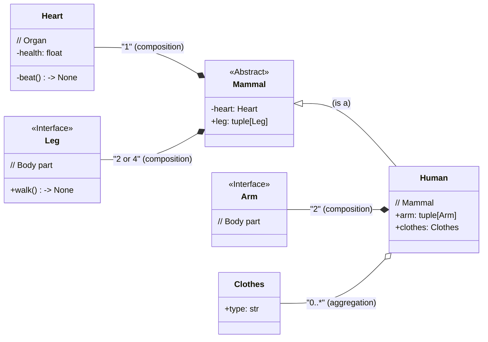

<!-- ============================================================== -->
<!-- == Header ==================================================== -->
<div align="center">

<!-- --- Title ---------------------------------------------------- -->

# `buildben`: build-benedictions

*Part of:*
<!-- --- Logo ----------------------------------------------------- -->
<a href="https://hisqu.de" target="_blank">
  
</a>

<br>

<!-- --- Badges --------------------------------------------------- -->

[](https://github.com/psf/black)

</div>

<!-- ============================================================== -->
<!-- == Abstract ================================================== -->
<div style="width: 85%; margin: 2rem auto; text-align: justify;">
<hr>

<blockquote> <i> A <b> benediction </b>(Latin: bene, 'well' + dicere, 'to speak') is a short invocation for divine help, blessing and guidance, usually at the end of worship service. </i> <sup> <a href="https://en.wikipedia.org/wiki/Benediction"> Wikipedia </a></sup> </blockquote>


#### `buildben` ...
<!-- Summarize the top 3 features -->
- ... = a Python development tool.
- ... standardizes project & experiment setups with template scaffolds
- ... integrates popular tools like `pipx`, `direnv`, `just`, etc.
- ... snapshots a project commit, lock file, and build artifacts for reproducible experiments


#### Main dependencies:
<!-- List your main dependencies here and explain why they're important. -->
- **[`uv`](https://github.com/astral-sh/uv)**: Awesome fast dependency manager & virtual environment tool, etc.
- **[`direnv`](https://direnv.net/)**: Auto-loads project-specific environment and provides  one-liners for environment management.
- **[`just`](https://github.com/casey/just)**: For running tasks to manage build tools & the virtual environment.

<!-- Dev dependencies: 
- **[`pipx`](https://pipx.pypa.io)**: The recommended home for `buildben`, making it accessible globally while keeping the OS-Python clean
- **Dependency groups:** Local dev tools live in `[dependency-groups]` and install with `python -m pip install -e "." --group dev`.
-->

<hr>
</div>
  


<!-- <div align="center">

  <p>
  <b> Graphical Abstract</b>: Buildben creates scaffolds for python projects adhering to Python PEP-standards.
  </p>
</div> -->


|  |
|:--:|
| **Fig. 1 - Graphical Abstract:** Buildben creates scaffolds for Python projects adhering to Python PEP standards. |

<br>


### Table of Contents

<!-- toc -->

1. [`buildben`: build-benedictions](#buildben-build-benedictions)
   1. [📦 Installation](#-installation)
      1. [Native installer entries](#native-installer-entries)
      1. [Authoring lifecycle artifacts](#authoring-lifecycle-artifacts)
      1. [Windows installer verification procedure](#windows-installer-verification-procedure)
      1. [Unix installer staging verification](#unix-installer-staging-verification)
      1. [Uninstall](#uninstall)
   2. [🚀 Usage](#-usage)
   3. [❓Optional Installs](#optional-installs)
   4. [📚  Examples / Documentation](#--examples--documentation)

<!-- tocstop -->
<!-- /toc -->

<br>

<!-- ============================================================== -->
<!-- == Installation ============================================== -->
## 📦 Installation

### Prerequisites

Editable pip installation needs Python `>=3.12` and a virtual environment.
The native installer can provision uv/Python without administrator privileges;
it does not require the application or AppRC to be installed first. Network
access is needed for selected sources, Python and unresolved dependencies.

### 🏃Quick & Dirty:
```bash
git clone https://github.com/HisQu/buildben.git
cd buildben
python -m pip install -e "."    # venv recommended
```

### Native installer entries

> [!IMPORTANT]
> This checkout uses the immutable AppRC source pins declared in `pyproject.toml`.
> Those sources can include unreleased SDK fixes; changing source pins and locks
> publishes neither Buildben nor AppRC. Use the checkout entries below to test
> changes that are not in the latest release.

From a complete checkout, run the Python developer entry:

```sh
python app-install.py
```

```powershell
python app-install.py
```

This installs the actual editable application project, including dirty local
changes. It does not archive `HEAD` or silently replace missing local payload
with downloaded code. If tracked artifacts are missing/stale, the author runs
`just make-artifacts`; CI uses `just check-artifacts` without rewriting.
Ordinary `python -m pip install -e .` remains supported and unmanaged by this
uv-tool lifecycle.

Published releases contain a strict integrity manifest, the wheel and original
source archive, four SDK-built native frontends (`buildben-install-*` and
`buildben-launch-*` for Linux x86-64 and Windows x86-64), and the standalone
Python installer payload. Download the native frontend for the host platform;
it carries the exact authored installer and verifies the matching source
archive before installation. The manifest binds every asset to its size,
digest, version, and immutable source commit. Do not combine assets from
different releases.

The root `app-install.sh` and `app-install.cmd` frontends are no longer
generated. The saved Windows `launch.cmd` and `launch.ps1` support remain
available for launching an installed application. Ordinary
`python -m pip install -e .` also remains supported and unmanaged by this
uv-tool lifecycle.

| Selection | Installer behavior |
| --- | --- |
| Complete checkout, no source override | Install the actual local project editable. |
| Downloaded release-native entry, no source override | Install the exact release embedded in that entry. |
| `--version X.Y.Z` | Install the selected published stable release. |
| `--main` | Resolve remote main once and install that captured commit's matching source/runtime inputs. |

`--main` cannot be combined with `--version`; it requires GitHub access and may
select unreleased code. The installer reports the captured source commit, since
the package version alone may also identify a release. Public access uses
anonymous requests. For authenticated access use `--github-client gh` after
`gh auth login` and `gh auth setup-git`; curl does not inherit gh credentials,
and private VCS dependencies still need Git authentication.

For an AppRC application, first installation offers OS-native versus single-root
placement, displays exact enabled resource paths, and explains the distinction:


- **Application resources:** config, persistent appdata, disposable cache and
  operational state, only when individually declared by the application.
- **Program environment:** Python, the uv-managed virtual environment and its
  dependencies. Choosing an application root does not relocate these.
- **Installation metadata:** durable support at a fixed native address, outside
  a chosen single root and outside disposable state.

Reinstallation keeps saved placement unless explicitly switched:

```sh
python app-install.py --layout native
python app-install.py --layout single-root --root "/absolute/path/application-files"
```

```powershell
python app-install.py --layout single-root --root 'D:\ApplicationFiles'
```

`--root` is valid only with single-root and must be absolute; native accepts no
root. A switch preserves previous owned resource locations as retired targets;
it does not automatically move arbitrary databases or user projects. Invocation
layout controls and `apprc.defaults.env` are not persistence for installer choices.

Buildben itself declares no AppRC data capabilities and has no AppRC runtime
dependency. It therefore creates no config/appdata/cache/state resource roots.
Its durable `installation.json` and current-platform support use:

| OS | Buildben installation directory |
| --- | --- |
| Linux | `${XDG_DATA_HOME:-~/.local/share}/buildben/installation` |
| macOS | `~/Library/Application Support/buildben/installation` |
| Windows | `%LOCALAPPDATA%\buildben\installation` |

The source generator lives in `src/buildben_distr/`; generated applications own
the corresponding `<app>_distr` package. Its ordinary-Python payload controls
project setup/cleanup while reusing AppRC's shared runtime. The saved Windows
`launch.cmd` and `launch.ps1` invoke application launch support; launch never
installs/syncs an environment. Buildben launches its direct CLI, while generated
AppRC applications expose their installed Textual `launcher` command.

Managed application environments use Python 3.13, selected by
`tool.apprc.distribution.runtime-python`. This runtime choice is independent of
`project.requires-python` (`>=3.12` here), which describes which interpreters
may install the package. The PyApp bootstrap itself uses Python 3.14; that
bootstrap version does not change the managed application's runtime.

### Authoring lifecycle artifacts

Keep project-specific prerequisites and cleanup in
`src/<app>_distr/payload/app_lifecycle/`; keep distribution identity and composition
in `src/<app>_distr/make_artifacts.py`. These are authoring inputs, not another
installed application package or an alternative lifecycle engine.

After changing those inputs:

```sh
uv sync --locked --all-groups
just make-artifacts
just check-artifacts
```

Commit the authored inputs and their generated outputs together. `check-artifacts`
compares expected bytes without rewriting them. Neither package build hooks nor
an end user's launch should regenerate artifacts or fetch missing checkout code.

The artifact authoring and staging recipes select the locked project environment
through uv. They do not require an activated virtual environment or direnv.
`just stage-release-assets TAG COMMIT` is the explicit release-only native
producer: it consumes the already-built wheel and original source archive, then
uses the pinned AppRC SDK to build Linux and Windows x86-64 installer/launcher
frontends. Linux native authoring requires Rust, LLVM/Clang/LLD, and pinned
`cargo-xwin`; the release workflow installs these tools. Ordinary
`just make-artifacts` and `just check-artifacts` remain Rust-free.

Buildben keeps `[project].dependencies` empty so ordinary Python installation
does not acquire application runtime dependencies. Release staging does not
replace that policy with hand-authored `DistributionSpec.runtime_requirements`
or `runtime_overrides`.

Generated AppRC applications group management commands in the **Maintenance**
help panel instead of mixing them with business commands. Use `<app> --help`,
`<app> installation show --json`, `<app> installation doctor`, and
`<app> installation uninstall --dry-run` for inspection; `<app> launcher` opens
the installed Textual launcher. These management entrypoints must remain usable
when business configuration is missing. Buildben itself keeps its direct CLI
and does not acquire an AppRC runtime dependency merely to provide installation.

### Windows installer verification procedure

Native Windows and macOS installation validation is currently deferred. The
maintained and scaffolded CI workflows run only on Linux with Python 3.12 and
3.13. Re-enabling native jobs requires a separately authorized validation pass.

For that Windows pass, restore a `windows-latest` case in the
[`installation` CI job](.github/workflows/ci.yml). Extend the existing
`tests/test_release_install.py`, not copied installer functions or a separate
harness. On the separately authorized native Windows runner, exercise the real
native `.exe` installer frontend and retained saved `launch.cmd` and
`launch.ps1` paths. Windows executable compilation and header inspection on Linux
do not establish native Windows behavior.

On the native Windows runner, run:

```powershell
uv run --locked python -m pytest -n 0 tests/test_release_install.py -k windows_installer
```

The source-install consumer smoke must also complete through
[`just release-install-smoke`](justfile), which checks real source installation
and saved uninstallation through both Windows entrypoints. Focused tests alone
do not replace that smoke. Linux checks are useful but do not prove Windows
installation or behavior.

> [!WARNING]
> From WSL, never launch native Windows verification executables: PowerShell,
> Windows Python/pytest, `cmd.exe`, or Windows `uv`, directly or through helpers.
> Do not use a cross-OS virtual environment as a workaround. Previous local
> attempts terminated the terminal; the cause is unknown. Output capture,
> `-NoProfile`, and `-NonInteractive` do not establish console isolation, and
> `CREATE_NO_WINDOW` is not a proven fix. Do not retry locally.

Native Windows verification requires a separately authorized independent runner;
this WSL terminal is not one. Observe authorized CI runs with Linux `gh` and
record actual results; configured CI is not evidence that a run completed. If
permissions, billing, or secrets block validation, record the concrete blocker
and leave native proof pending. Explicitly authorized Linux-only integration may
proceed with that gap recorded; it does not establish Windows release readiness
or authorize publishing. Do not change billing, policy, or security settings or
publish artifacts to bypass a blocker. Pushes still require explicit authorization.

### Unix installer staging verification

Run [`just release-install-smoke`](justfile) after changing Unix staging.
The maintained [consumer tests](tests/test_release_install.py) exercise release
and pinned-main sources through both the canonical installer and the Unix
installer rendered by the real scaffolder. Cover physical and symlinked
temporary parents, actual installation, saved uninstallation, and cleanup.
The existing macOS `installation` jobs must execute successfully before release;
main integration with that native gap requires the same explicit user override
described in the [Windows procedure](#windows-installer-verification-procedure).

Normalize only the newly created installer-owned staging root before deriving
extracted-source paths. A macOS system alias such as `/var` must not make valid
staging fail lifecycle validation. Do not resolve arbitrary lifecycle or
preflight inputs to bypass their link checks; keep the rejection coverage in
[`tests/test_lifecycle.py`](tests/test_lifecycle.py).

Generated-consumer cases must invoke the real scaffolder and AppRC generator,
then install that consumer's own source—not reuse Buildben as a stand-in.
Keep both kinds of evidence: canonical Buildben exercises a zero-data
application, while generated applications exercise declared resources and
project-specific setup/cleanup alongside the shared lifecycle.

### Uninstall

Installer-based installations save inspection/removal support outside the
removable application environment. Use the native path printed by installation,
or dispatch through the complete checkout:

```sh
./app-uninstall.sh --dry-run
./app-uninstall.sh --yes
```

```powershell
.\app-uninstall.cmd --dry-run
.\app-uninstall.cmd --yes
```

Default removal is **program-only**. It verifies actual backend absence, retains
reconnectable placement/support and records `removed-retained`, not a fictitious
installed version. For generated applications it retains every config/appdata/
cache/state resource. Buildben has none. Editable checkout files, workspaces,
shared uv/Python, shell configuration and unrelated tools are never implicit
removal targets. There is no inherited legacy `--remove-uv` permission.

Complete removal is separate. Buildben's zero-resource example removes its
remaining owned support/authority after confirming the preview:

```sh
./app-uninstall.sh --dry-run --complete
./app-uninstall.sh --complete --yes
```

Generated applications additionally select exact owned resource categories with
repeatable `--category config|appdata|cache|state`. Persistent config/appdata
deletion needs explicit consent; `--yes` does not bypass ownership, unknown-file,
revision or generation checks. `--forget-retained` names retained files in its
preview and deliberately leaves them unmanaged; it never means they were deleted.

Saved inspection/dry-run is read-only: no uv bootstrap, downloads, environment
creation or resource initialization. It needs an already available suitable
Python; otherwise it reports that prerequisite. Mutating removal may provision
its pinned management dependencies through uv, but uses the saved app-specific
procedure instead of downloading newer cleanup code. Keep the recorded uv/base
Python available. The independent controller waits for the actual caller and its
owned foreground children to exit before deleting the environment.

Incomplete work retains progress and a matching saved/external recovery command.
Unknown contents and provider failures retain authority rather than claiming
complete deletion. Complete removal deletes `installation.json` last; afterward
only lock retirement and empty-container cleanup may occur. Safe lock residue
under contention is reported, not used as permission to delete a new generation.

Legacy Buildben receipts are not adopted by the current installer or AppRC
installation authority. Finish any operation started by the old installer
before removing its managed program. Back up user data first, and use the old
generation's own removal procedure with its resource-preserving option; if that
procedure cannot clearly preserve the resource directories, stop and resolve
that with the old generation before proceeding. Do not fabricate a current
installation record from a receipt or version label. After the old managed
program is removed and its resources are preserved, install the current
checkout as a fresh installation:

```sh
python app-install.py --layout native
```

Use `python app-install.py --layout native` on Windows as well. Current
installation authority does not recognize schema-1 receipts or recover their
operations. The unmanaged editable pip and uv tool removal guidance below
applies only when no managed installation authority exists.

For an unmanaged editable pip installation, use that environment's
`python -m pip uninstall buildben`. For a manually installed uv tool without
managed authority, use `uv tool uninstall buildben` with its original
`UV_TOOL_DIR`/`UV_TOOL_BIN_DIR`; do not fabricate a receipt or treat another
environment discovered on PATH as its owner.


### Install from a cloned repository


#### 3. Install [`just`](https://github.com/casey/just):
```bash
sudo apt install just     # For Ubuntu
# brew install just       # For MacOS
# pipx install rust-just  # Windows requires the cross-platform version (not tested!)
```


#### 4. Install [`direnv`](https://direnv.net/) & hook it into your shell: 
   - *Either* follow the instructions for [install](https://direnv.net/docs/installation.html) & [hook](https://direnv.net/docs/hook.html),
   - *Or* run `src/buildben/setup_zsh.sh` to install both `zsh` & other useful plugins, including `direnv`.

```bash
# === Example for Ubuntu + zsh =============
sudo apt install direnv
# Add direnv plugin (or just the hook) if missing
RCFILE="${ZDOTDIR:-$HOME}/.zshrc" # Respect ZDOTDIR if user set it
if ! grep -q 'direnv ' "$RCFILE"; then
    sed -i 's/^plugins=(/plugins=(direnv /' "$RCFILE"
fi
```


### ✅ Verify installation:
```bash
bube        # Prints help when no args are given
# buildben  # Alias for bube
```

<br>


<!-- ============================================================== -->
<!-- == Usage ===================================================== -->
## 🚀 Usage

### Projects


<div align="center">

  <p><em> 
  <b> Architecture of projects </b>
  </em></p>
</div>


```bash
# > Create a Python-only project; name is positional.
bube init-proj my_project -t . -u your_github_username -g

# > Include the optional React/TypeScript/Vite frontend.
bube init-proj my_project -t . -u your_github_username --frontend react
```

The optional frontend is an independent Bun project in `frontend/`. Generation
copies bundled files and a maintained `bun.lock`; it does not install runtimes,
download dependencies, or change Python dependency metadata. Use Node 24.22.2+
(within Node 24), Bun >=1.4.4, and just with module support (CI uses 1.56.0).

From the generated root:

```bash
just --list
just --list front
just front sync
just front dev
just front check
just front test
just front build
```

Root listing groups the module under `Frontend`; `--list front` expands its
recipes. Frozen sync preserves the committed lockfile. Checks include TypeScript
and ESLint; tests use Vitest through `bun run test`, not Bun's separate runner.
The build checks types before Vite emits `frontend/dist/`.

React, Vite, TypeScript, linting and component-test packages live only in
`frontend/package.json` and `frontend/bun.lock`. Root `just sync` remains
Python-only; frontend assets are not automatically shipped inside Python
distributions or served by the Python application. To add Vite manually to an
existing frontend, run `bun add -d vite` inside that project, not in dotfiles
or during routine sync.

The generated project includes six documentation pages. They use fixed page
labels and introduce components before instructions that depend on them:

- `docs/README.md`: Documentation, the reading order and authoring rules.
- `docs/Explanations.md`: Explanations, each component's job and connections.
- `docs/How-To-User-Guides.md`: How-to user guides, tasks with prerequisites and expected results.
- `docs/References.md`: References, exact commands, paths, keys, and Python names.
- `docs/EXAMPLES.md`: Examples, complete storage and configuration setups.
- `docs/Development.md`: Development, verification and release instructions.

The root `CONTRIBUTING.md` owns shared working conventions and the normal
development setup and checks; `AGENTS.md` directs coding agents to those rules.
The generated README provides grouped navigation for users and contributors
instead of duplicating development commands.

Generated projects also include `.github/workflows/diagnostics.yml`, an isolated
Actions artifact upload/download check requiring no checkout or Python setup.
The generated [developer guide](src/buildben/_templates_proj/_docs-Development.md#actions-artifact-diagnostic)
explains the initial `diagnostics/artifact-upload` branch push, later manual
invocation, and deletion of the tiny test artifact (one-day fallback retention).
It checks Actions artifact storage, not GitHub Release uploads, PyPI publication,
or application correctness.

The starter has a Typer CLI, `python -m <my_project>` support, and AppRC
configuration. Its `APP_RC` enables the `config` and `appdata` capabilities,
without enabling user dotenv support by default. The shared declaration
registers typed config sections; a config bundle passes those sections to
application code. Use `config init` and `appdata init` to initialize the
respective resource categories and ownership markers. `config setup` is
available when user dotenv is enabled.

> [!IMPORTANT]
> Generated projects pin matching SDK sources for `apprc-core`, `apprc`, and
> optional `apprc-gui` to one immutable Git commit. A source pin can include fixes
> absent from the published SDK version. Buildben itself has no AppRC runtime
> dependency.

The maintained `tests/test_init_proj.py` and `tests/test_lifecycle.py` suites
scaffold real generated projects and exercise their SDK-generated artifacts and
consumer lifecycle. Run both full modules for local generated-consumer
verification:

```sh
uv run --locked python -m pytest tests/test_init_proj.py tests/test_lifecycle.py
```


The default test suite skips the opt-in native release canary and remains
Rust-free. On Linux, run the canary serially with Rust, LLVM/Clang/LLD, and the
locked `cargo-xwin` toolchain:

```sh
APPRC_TEST_PYAPP=1 uv run --locked python -m pytest -n 0 tests/test_release_install.py -k generated_native_release_install
```

For a local AppRC SDK checkout, optionally set `APPRC_TEST_SDK_SOURCE` to its
path and `APPRC_TEST_SDK_REVISION` to its full commit before the command. The
canary builds and exercises the staged Linux executable; it does not establish
Windows runtime behavior.
When working against a local AppRC source change, provide its matching local
packages through the repository's existing test environment; do not replace the
immutable generated-project source pins with a released-version range.

#### Create virtual environment (``/.direnv``):

```bash
cd <my_project_name> # Changing directory will auto-create the venv
# ==> You will be prompted to allow the direnv to activate!
# direnv allow
```

#### Install dependency profiles:
```bash
python -m pip install -e "."              # Core runtime dependencies
python -m pip install -e ".[rag]"         # Core + published RAG extra
python -m pip install -e "." --group dev  # Core + local dev tools
python -m pip install -e ".[rag]" --group dev
```
The `rag` commands apply after the commented `rag` extra in `pyproject.toml` is
uncommented and populated.
<details> <summary> Equivalent uv / just commands </summary>

  - `just core`: `uv sync --locked --no-default-groups`
  - `just rag`: `uv sync --locked --all-extras --no-default-groups`
  - `just dev`: `uv sync --locked --all-groups`
  - `just rag-dev`: `uv sync --locked --all-extras --all-groups`
  - `--all-extras` installs published extras from `[project.optional-dependencies]`, such as `rag`.
  - `--all-groups` installs local dependency groups from `[dependency-groups]`, such as `dev`.
  - `--no-default-groups` skips uv's default local groups for a runtime-only install.

</details>

#### List `just` recipes:
*Recipes* (=functions) are defined in the `justfile`. Edit them or add more as you like! 
`just --list` displays recipes grouped by task.
```bash
just  # Alias for `just --list`. 
```

#### 'Uninstall' Project:
```bash
rm -rf ../my_project  # Simply delete the project folder
```

<hr>


### Experiments
Experiments are defined as scripts meant to use, test, validate, etc.
your current project. They will be collected inside the `experiments`
directory inside the project root, including templates for Reports, outputs, etc.!

```bash
# From inside your project:
bube add-experim experiment1 # Alias: `bube exp experiment1`
# > Creates the scaffold in `./experiments/2025-06-13_experiment1`
```

<hr>

### Snapshots
You can create a snapshot of your current project, sparing you the
headache of PyPI releases and semantic versioning. This is useful for
e.g. reproducing your experiment after the project has changed. It works by
capturing the current commit hash, exporting locked requirements with `uv`,
and building local wheel/sdist artifacts.
```bash
# From inside your project:
bube env-snapshot experiments/2025-06-13_experiment1
# > Creates experiment.env, requirements.lock, wheel, and sdist artifacts
```

### Maintainer releases

Buildben keeps its PyPI policy in the `justfile`:

```just
RELEASE_PYPI := "false"
```

Keep it at `"false"` for GitHub-only releases. Set it to `"true"` once for a
public package after configuring PyPI trusted publishing for the `pypi` GitHub
environment.

> [!IMPORTANT]
> Edit and commit this setting before the release. Shell variables and
> `just --set` overrides are not stored in the tag and cannot select PyPI.

```bash
just release-check
just release patch
```
`just build-release-inputs` accepts an optional positional release-notes path:

```bash
just build-release-inputs release/prepared-notes.md
```

Use this to reuse notes that have already been validated. The file must be
outside `dist`, because the recipe rebuilds that directory. Omit the argument
to generate notes from the changelog; either way, tag and version validation
still runs.

> [!WARNING]
> `just release` creates the version commit and annotated tag, then atomically
> pushes `main` and the tag. Use `just release-prepare patch` when you only want
> the checked local commit and tag.

Manual PyPI publication is available only when both the current committed
`justfile` and the target tag's committed `justfile` set
`RELEASE_PYPI := "true"`. If a GitHub Release exists and that policy is true,
publish its attached wheel and source archive without rebuilding them:

```bash
just publish-pypi vMAJOR.MINOR.PATCH
```

The command checks both committed policies before GitHub authentication or
network calls. When either policy is `"false"`, it exits without contacting
GitHub. The manual workflow applies the same check to the selected workflow ref
and target tag. When both are true, its unprivileged preflight validates the
Release assets, records their hashes and release/tag/commit identities in a
manifest, and uploads that exact snapshot. The PyPI job publishes only the
snapshot identified by the preflight artifact ID.

The preflight detects a tag update or deletion during asset capture. Preventing
an administrator from changing or deleting the tag while preflight is running
requires repository tag protection or rulesets. This code does not configure
or verify those settings. GitHub Actions performs an allowed PyPI upload
through trusted publishing.


<br>


<!-- ============================================================== -->
<!-- == Optionals ================================================= -->

## ❓Optional Installs

### Use `direnv` & `just` in VS Code:

#### Select Python Interpreter:
This needs to be repeated for every new workspace folder!
1. Press ``Ctrl + Shift + P``; search & select *"Python: Select Interpreter"*
2. It will list workspace folders. Select the one you want to assign the direnv-interpreter to.
3. It will list available interpreters `.direnv/python-3.x.y` should be next to the global ones (VS Code documentation claims it knows `direnv` out-of-the-box!).
4. If it does not appear, then try adding this to your ``settings.json`` & replace ``<path_to_your_projects>`` with the actual parent folder where you store your projects. It must be within your home directory, and VS Code must have permission to that folder!


```json
// Optional: Patterns inside the home directory that point to a parent folder containing a venv or python-3.x.y:
  "python.venvFolders": [ "user/<path_to_your_projects>/*/.direnv" ],
```
5. You might also try activating "python.terminal.activateEnvironment" in the VS Code settings.


#### Install VS Code Extensions:
```bash
code --install-extension mkhl.direnv 
code --install-extension nefrob.vscode-just
```

<br>

### [`Mermaid`](https://mermaid.js.org/) - For Quick & Dirty Diagrams

#### Install VS Code Extension:
```bash
code --install-extension vstirbu.vscode-mermaid-preview
```
``Mermaid`` runs natively in GitHub & Markdown-tools.


### [`graphigs`](https://github.com/markur4/graphigs) - For Big Figures

Buildben owns the source for repository figures in `assets/figures`, beside the
generated SVG and PNG files. The scripts import `graphigs` for shared Graphviz
helpers, size checks, and SVG/PNG export normalization.

#### Install the system layout engine:

```bash
sudo apt-get install graphviz              # For Ubuntu
# brew install graphviz                    # For MacOS
# winget install -e --id Graphviz.Graphviz # Windows
```

#### Render the repository figures:

```bash
just figures
# or run one colocated renderer:
uv run --locked python assets/figures/diagram_graphviz.py
```

New project scaffolds copy flowchart and class diagram starters from Graphigs.
After installing Graphigs in the maintainer environment, refresh the snapshots
with `PYTHONPATH=src python -m buildben_dev.sync_mermaid_templates`. Add
`--check` to report stale snapshots without writing files.
<br>


<!-- ============================================================== -->
<!-- == Examples ================================================== -->


## 📚  Examples / Documentation 

### Diagrams

| **Feature**       | **``Mermaid``**                                         | **``Graphviz``**                                                   |
| ----------------- | --------------------------------------------------- | -------------------------------------------------------------- |
| **Ease of Use**   | 🟢 Simple, Markdown-like syntax; quick to learn and use  | 🟡 DOT-based layout with Python helper scripts |
| **Integration**   | 🟢 Native to GitHub and Markdown-tools, no extra installs      | 🟡 Requires the Graphviz system package |
| **Functionality** | 🔴 Limited styling and diagram types                     | 🟢 Strong graph layout, SVG/PNG export, reusable styling helpers |


#### `Mermaid`  flowchart (code inside `README.md`):


####  `Mermaid`  Class Diagram (code inside `README.md`):

