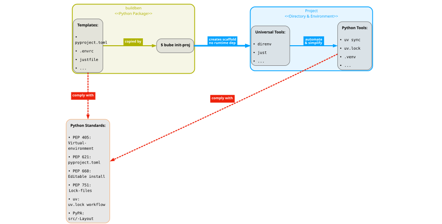
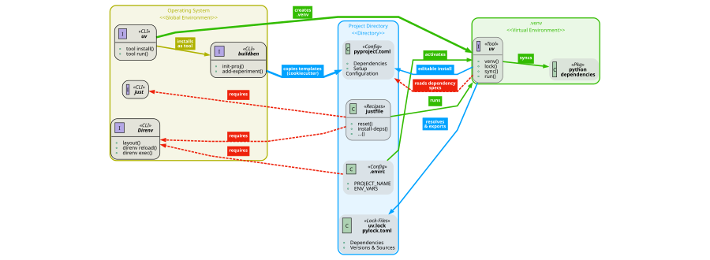
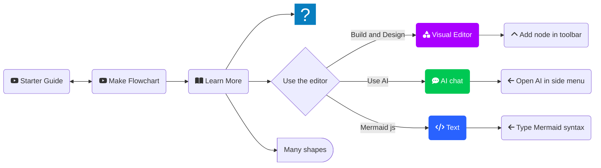
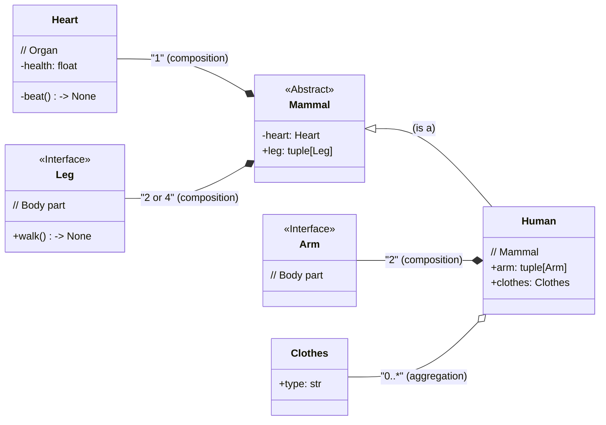

<!-- ============================================================== -->
<!-- == Header ==================================================== -->
<div align="center">

<!-- --- Title ---------------------------------------------------- -->

# `buildben`: build-benedictions

*Part of:*
<!-- --- Logo ----------------------------------------------------- -->
<a href="https://hisqu.de" target="_blank">
  
</a>

<br>

<!-- --- Badges --------------------------------------------------- -->

[](https://github.com/psf/black)

</div>

<!-- ============================================================== -->
<!-- == Abstract ================================================== -->
<div style="width: 85%; margin: 2rem auto; text-align: justify;">
<hr>

<blockquote> <i> A <b> benediction </b>(Latin: bene, 'well' + dicere, 'to speak') is a short invocation for divine help, blessing and guidance, usually at the end of worship service. </i> <sup> <a href="https://en.wikipedia.org/wiki/Benediction"> Wikipedia </a></sup> </blockquote>


#### `buildben` ...
<!-- Summarize the top 3 features -->
- ... = a Python development tool.
- ... standardizes project & experiment setups with template scaffolds
- ... integrates popular tools like `pipx`, `direnv`, `just`, etc.
- ... snapshots a project commit, lock file, and build artifacts for reproducible experiments


#### Main dependencies:
<!-- List your main dependencies here and explain why they're important. -->
- **[`uv`](https://github.com/astral-sh/uv)**: Awesome fast dependency manager & virtual environment tool, etc.
- **[`direnv`](https://direnv.net/)**: Auto-loads project-specific environment and provides  one-liners for environment management.
- **[`just`](https://github.com/casey/just)**: For running tasks to manage build tools & the virtual environment.

<!-- Dev dependencies: 
- **[`pipx`](https://pipx.pypa.io)**: The recommended home for `buildben`, making it accessible globally while keeping the OS-Python clean
- **Dependency groups:** Local dev tools live in `[dependency-groups]` and install with `python -m pip install -e "." --group dev`.
-->

<hr>
</div>
  


<!-- <div align="center">

  <p>
  <b> Graphical Abstract</b>: Buildben creates scaffolds for python projects adhering to Python PEP-standards.
  </p>
</div> -->


|  |
|:--:|
| **Fig. 1 - Graphical Abstract:** Buildben creates scaffolds for Python projects adhering to Python PEP standards. |

<br>


### Table of Contents

<!-- toc -->

1. [`buildben`: build-benedictions](#buildben-build-benedictions)
   1. [📦 Installation](#-installation)
      1. [Native installer entries](#native-installer-entries)
      1. [Authoring lifecycle artifacts](#authoring-lifecycle-artifacts)
      1. [Windows installer verification procedure](#windows-installer-verification-procedure)
      1. [Unix installer staging verification](#unix-installer-staging-verification)
      1. [Uninstall](#uninstall)
   2. [🚀 Usage](#-usage)
   3. [❓Optional Installs](#optional-installs)
   4. [📚  Examples / Documentation](#--examples--documentation)

<!-- tocstop -->
<!-- /toc -->

<br>

<!-- ============================================================== -->
<!-- == Installation ============================================== -->
## 📦 Installation

### Prerequisites

Editable pip installation needs Python `>=3.12` and a virtual environment.
The native installer can provision uv/Python without administrator privileges;
it does not require Buildben or AppRC to be installed first. Network and Git
credentials may be needed for locked Python/dependency acquisition.

### 🏃Quick & Dirty:
```bash
git clone https://github.com/HisQu/buildben.git
cd buildben
python -m pip install -e "."    # venv recommended
```

### Native installer entries

Native setup embeds the complete committed project and `uv.lock`, rather than
selecting a remote branch, release or wheel at installation time. Run
`buildben-setup-linux-x86_64` on Linux or
`buildben-setup-windows-x86_64.exe` on Windows after verifying its entry in
`SHA256SUMS`. These names apply only to releases that contain the new assets;
this source update does not publish one.

The stable installed command is **`bube`**, from
`tool.apprc.distribution.command-name`. Business commands run in its recorded
locked runtime slot, regardless of the shell's active environment.
Core maintenance uses the native manager independently:

```sh
bube app paths --json
bube app doctor --json
bube app repair
```

Buildben itself retains its ordinary argparse CLI and an empty
`[project].dependencies`. Native management does not add AppRC as an application
runtime dependency. An unmanaged `python -m pip install -e .` remains supported;
it does not acquire a managed installation record.

Generated AppRC applications instead provide first-class editable registration:

```sh
uv run --locked <app> app install -e
```

This registers the checkout's existing `.venv` without copying or owning it.
Git/uv handle updates and recovery; this lightweight developer path deliberately
does not add an independent native bootstrap.

Application resource placement remains distinct from the program:

- OS-native or explicit single-root config/appdata/cache/state, only when
  declared by the application.
- Managed Python and dependencies in immutable-location runtime slots.
- Fixed native installation authority outside disposable resources.

Buildben declares no application resource categories. Its installation
authority remains at these locations:

| OS | Buildben installation directory |
| --- | --- |
| Linux | `${XDG_DATA_HOME:-~/.local/share}/buildben/installation` |
| macOS | `~/Library/Application Support/buildben/installation` |
| Windows | `%LOCALAPPDATA%\buildben\installation` |

Managed runtime Python is 3.13, declared separately from package compatibility
(`>=3.12`) and PyApp's Python 3.14 management bootstrap. uv owns application
dependency synchronization; AppRC does not implement another resolver.

### Authoring lifecycle artifacts

Keep build composition in the authored `src/<app>_distr` package. Application
lifecycle hooks are importable `module:function` providers in the application,
not copied/generated Python payloads.

```sh
uv sync --locked --all-groups
just make-artifacts
```

The builder exports one complete Git snapshot, validates its committed lock and
workspace paths, builds declared frontend assets on that private copy, and
compiles the native setup. Authoring now requires the existing Rust,
LLVM/Clang/LLD and pinned `cargo-xwin` toolchain plus uv 0.13.6. This is an
authoring prerequisite, not a recipient bootstrap requirement; recipients do
not need uv or the native compiler toolchain.

Commit authored inputs and lockfiles, **not** generated outputs.
`.cache/apprc/` contains ignored intermediates; ignored `dist/` contains exactly:

| File | Purpose |
| --- | --- |
| `buildben-setup-linux-x86_64` | Linux setup and installed native manager. |
| `buildben-setup-windows-x86_64.exe` | Windows setup and installed native manager. |
| `SHA256SUMS` | SHA-256 integrity entries for the two setup executables. |

Standard wheel/sdist package builds are separate from that three-file native
contract. There is no generated helper forest, private wheelhouse, separate
launcher asset, wheel override injection or `--main`/`--version` source selector.

Hybrid generated repositories build React assets before snapshotting, exclude
node_modules/build intermediates and ship static files as Python package data.
The author needs Bun; installation and normal use do not.

Generated AppRC apps use `config`, optional `workspace` and `app` maintenance
groups. `<app> launch` opens the existing Textual management launcher through
the selected application runtime; it is not another native executable.

### Windows installer verification procedure

Native Windows and macOS installation validation remains deferred. Maintained
and generated CI runs on Linux with Python 3.12/3.13; do not add runners, spending
or security-policy changes as part of ordinary source integration.

A separately authorized Windows pass must exercise the actual setup, stable
native command, updates, repair, shortcuts and final self-removal through the
maintained consumer suite—not removed CMD/PowerShell wrappers. Cross-compilation
and PE-header checks do not prove those operations.

> [!WARNING]
> Never launch Windows verification through WSL: this includes PowerShell,
> Windows Python/pytest, `cmd.exe` and Windows uv, directly or through helpers.
> Captured output, `-NoProfile`, `-NonInteractive` or `CREATE_NO_WINDOW` do not
> establish isolation. Earlier attempts terminated the terminal; do not retry.

Observe authorized independent native runs with Linux `gh` and record their
actual outcome. A runner/billing/credential blocker leaves that platform
unverified; it does not authorize publication or bypasses. Linux-only main
integration is authorized for this cutover, not Windows release readiness.

### Unix installer staging verification

Use the maintained consumer suite and native installation smoke after source
owners freeze. It must install the real embedded snapshot, not an echoed
command or mocked resolver. Cover safe temporary/home aliases without weakening
rejection of untrusted links.

Exercise Buildben as the zero-AppRC-dependency consumer and generated apps as
actual scaffolded consumers. Python-only, multi-package workspace and hybrid
cases must install their own source; a successful Buildben install cannot prove
their resource hooks or packaged frontend assets.

Linux evidence does not establish macOS behavior. Runtime selection must ignore
ambient virtual environments, failed replacement must keep the old runtime
usable, and live child leases must prevent retirement without losing recovery
authority.

### Uninstall

The installed native command provides independent program-only removal:

```sh
bube app uninstall --dry-run
bube app uninstall --yes
```

If that command is missing, use the matching original setup's `app uninstall`
action. No checkout or generated uninstall script is required. Native
finalization waits for its initiator before removing owned runtime/command
files; unknown content, changed revisions and live leases prevent unsafe
deletion.

Default removal preserves every application resource. Buildben has none;
generated apps can declare config/appdata/cache/state. Editable registration
never owns its checkout or environment. Shared uv/Python, shell profiles,
workspaces and unrelated tools are not implicit removal targets.

For generated applications, complete resource removal additionally requires an
exact inventory and explicit category/consent. An unavailable application hook
blocks dependent data purge without blocking independent program removal.
`--forget-retained` leaves named retained files unmanaged, not deleted.

Installation schema `3` rejects older authority and Buildben receipts. Finish
old operations, back up user data and retire the old program with its own
resource-preserving removal before a fresh install. Do not edit a schema number
or fabricate a record; there is no converter or compatibility layer.

Unmanaged editable installations remain outside this lifecycle: use their own
`python -m pip uninstall buildben`. A manually installed uv tool without
managed authority remains owned by its original uv tool directory.

### Install from a cloned repository


#### 3. Install [`just`](https://github.com/casey/just):
```bash
sudo apt install just     # For Ubuntu
# brew install just       # For MacOS
# pipx install rust-just  # Windows requires the cross-platform version (not tested!)
```


#### 4. Install [`direnv`](https://direnv.net/) & hook it into your shell: 
   - *Either* follow the instructions for [install](https://direnv.net/docs/installation.html) & [hook](https://direnv.net/docs/hook.html),
   - *Or* run `src/buildben/setup_zsh.sh` to install both `zsh` & other useful plugins, including `direnv`.

```bash
# === Example for Ubuntu + zsh =============
sudo apt install direnv
# Add direnv plugin (or just the hook) if missing
RCFILE="${ZDOTDIR:-$HOME}/.zshrc" # Respect ZDOTDIR if user set it
if ! grep -q 'direnv ' "$RCFILE"; then
    sed -i 's/^plugins=(/plugins=(direnv /' "$RCFILE"
fi
```


### ✅ Verify installation:
```bash
bube        # Prints help when no args are given
# buildben  # Alias for bube
```

<br>


<!-- ============================================================== -->
<!-- == Usage ===================================================== -->
## 🚀 Usage

### Projects


<div align="center">

  <p><em> 
  <b> Architecture of projects </b>
  </em></p>
</div>


```bash
# > Create a Python-only project; name is positional.
bube init-proj my_project -t . -u your_github_username -g

# > Include the optional React/TypeScript/Vite frontend.
bube init-proj my_project -t . -u your_github_username --frontend react
```

The optional frontend is an independent Bun project in `frontend/`. Generation
copies bundled files and a maintained `bun.lock`; it does not install runtimes,
download dependencies, or change Python dependency metadata. Use Node 24.22.2+
(within Node 24), Bun >=1.4.4, and just with module support (CI uses 1.56.0).

From the generated root:

```bash
just --list
just --list front
just front sync
just front dev
just front check
just front test
just front build
```

Root listing groups the module under `Frontend`; `--list front` expands its
recipes. Frozen sync preserves the committed lockfile. Checks include TypeScript
and ESLint; tests use Vitest through `bun run test`, not Bun's separate runner.
The build checks types before Vite emits `frontend/dist/`.

React, Vite, TypeScript, linting and component-test packages live only in
`frontend/package.json` and `frontend/bun.lock`. Root `just sync` remains
Python-only; frontend assets are not automatically shipped inside Python
distributions or served by the Python application. To add Vite manually to an
existing frontend, run `bun add -d vite` inside that project, not in dotfiles
or during routine sync.

The generated project includes six documentation pages. They use fixed page
labels and introduce components before instructions that depend on them:

- `docs/README.md`: Documentation, the reading order and authoring rules.
- `docs/Explanations.md`: Explanations, each component's job and connections.
- `docs/How-To-User-Guides.md`: How-to user guides, tasks with prerequisites and expected results.
- `docs/References.md`: References, exact commands, paths, keys, and Python names.
- `docs/EXAMPLES.md`: Examples, complete storage and configuration setups.
- `docs/Development.md`: Development, verification and release instructions.

The root `CONTRIBUTING.md` owns shared working conventions and the normal
development setup and checks; `AGENTS.md` directs coding agents to those rules.
The generated README provides grouped navigation for users and contributors
instead of duplicating development commands.

Generated projects also include `.github/workflows/diagnostics.yml`, an isolated
Actions artifact upload/download check requiring no checkout or Python setup.
The generated [developer guide](src/buildben/_templates_proj/_docs-Development.md#actions-artifact-diagnostic)
explains the initial `diagnostics/artifact-upload` branch push, later manual
invocation, and deletion of the tiny test artifact (one-day fallback retention).
It checks Actions artifact storage, not GitHub Release uploads, PyPI publication,
or application correctness.

The starter has a Typer CLI, `python -m <my_project>` support, and AppRC
configuration. Its `APP_RC` enables the `config` and `appdata` capabilities,
without enabling user dotenv support by default. The shared declaration
registers typed config sections; a config bundle passes those sections to
application code. Use `config init` and `appdata init` to initialize the
respective resource categories and ownership markers. `config setup` is
available when user dotenv is enabled.

> [!IMPORTANT]
> Generated projects pin matching SDK sources for `apprc-core`, `apprc`, and
> optional `apprc-gui` to one immutable Git commit. A source pin can include fixes
> absent from the published SDK version. Buildben itself has no AppRC runtime
> dependency.

The maintained `tests/test_init_proj.py` and `tests/test_lifecycle.py` suites
scaffold real generated projects and exercise their SDK-generated artifacts and
consumer lifecycle. Run both full modules for local generated-consumer
verification:

```sh
uv run --locked python -m pytest tests/test_init_proj.py tests/test_lifecycle.py
```


The default test suite skips the opt-in native release canary and remains
Rust-free. On Linux, run the canary serially with Rust, LLVM/Clang/LLD, and the
locked `cargo-xwin` toolchain:

```sh
APPRC_TEST_PYAPP=1 uv run --locked python -m pytest -n 0 tests/test_release_install.py -k generated_native_release_install
```

For a local AppRC SDK checkout, optionally set `APPRC_TEST_SDK_SOURCE` to its
path and `APPRC_TEST_SDK_REVISION` to its full commit before the command. The
canary builds and exercises the staged Linux executable; it does not establish
Windows runtime behavior.
When working against a local AppRC source change, provide its matching local
packages through the repository's existing test environment; do not replace the
immutable generated-project source pins with a released-version range.

#### Create virtual environment (``/.direnv``):

```bash
cd <my_project_name> # Changing directory will auto-create the venv
# ==> You will be prompted to allow the direnv to activate!
# direnv allow
```

#### Install dependency profiles:
```bash
python -m pip install -e "."              # Core runtime dependencies
python -m pip install -e ".[rag]"         # Core + published RAG extra
python -m pip install -e "." --group dev  # Core + local dev tools
python -m pip install -e ".[rag]" --group dev
```
The `rag` commands apply after the commented `rag` extra in `pyproject.toml` is
uncommented and populated.
<details> <summary> Equivalent uv / just commands </summary>

  - `just core`: `uv sync --locked --no-default-groups`
  - `just rag`: `uv sync --locked --all-extras --no-default-groups`
  - `just dev`: `uv sync --locked --all-groups`
  - `just rag-dev`: `uv sync --locked --all-extras --all-groups`
  - `--all-extras` installs published extras from `[project.optional-dependencies]`, such as `rag`.
  - `--all-groups` installs local dependency groups from `[dependency-groups]`, such as `dev`.
  - `--no-default-groups` skips uv's default local groups for a runtime-only install.

</details>

#### List `just` recipes:
*Recipes* (=functions) are defined in the `justfile`. Edit them or add more as you like! 
`just --list` displays recipes grouped by task.
```bash
just  # Alias for `just --list`. 
```

#### 'Uninstall' Project:
```bash
rm -rf ../my_project  # Simply delete the project folder
```

<hr>


### Experiments
Experiments are defined as scripts meant to use, test, validate, etc.
your current project. They will be collected inside the `experiments`
directory inside the project root, including templates for Reports, outputs, etc.!

```bash
# From inside your project:
bube add-experim experiment1 # Alias: `bube exp experiment1`
# > Creates the scaffold in `./experiments/2025-06-13_experiment1`
```

<hr>

### Snapshots
You can create a snapshot of your current project, sparing you the
headache of PyPI releases and semantic versioning. This is useful for
e.g. reproducing your experiment after the project has changed. It works by
capturing the current commit hash, exporting locked requirements with `uv`,
and building local wheel/sdist artifacts.
```bash
# From inside your project:
bube env-snapshot experiments/2025-06-13_experiment1
# > Creates experiment.env, requirements.lock, wheel, and sdist artifacts
```

### Maintainer releases

Buildben keeps its PyPI policy in the `justfile`:

```just
RELEASE_PYPI := "false"
```

Keep it at `"false"` for GitHub-only releases. Set it to `"true"` once for a
public package after configuring PyPI trusted publishing for the `pypi` GitHub
environment.

> [!IMPORTANT]
> Edit and commit this setting before the release. Shell variables and
> `just --set` overrides are not stored in the tag and cannot select PyPI.

```bash
just release-check
just release patch
```
`just build-release-inputs` accepts an optional positional release-notes path:

```bash
just build-release-inputs release/prepared-notes.md
```

Use this to reuse notes that have already been validated. The file must be
outside `dist`, because the recipe rebuilds that directory. Omit the argument
to generate notes from the changelog; either way, tag and version validation
still runs.

> [!WARNING]
> `just release` creates the version commit and annotated tag, then atomically
> pushes `main` and the tag. Use `just release-prepare patch` when you only want
> the checked local commit and tag.

Manual PyPI publication is available only when both the current committed
`justfile` and the target tag's committed `justfile` set
`RELEASE_PYPI := "true"`. If a GitHub Release exists and that policy is true,
publish its attached wheel and source archive without rebuilding them:

```bash
just publish-pypi vMAJOR.MINOR.PATCH
```

The command checks both committed policies before GitHub authentication or
network calls. When either policy is `"false"`, it exits without contacting
GitHub. The manual workflow applies the same check to the selected workflow ref
and target tag. When both are true, its unprivileged preflight validates the
Release assets, records their hashes and release/tag/commit identities in a
manifest, and uploads that exact snapshot. The PyPI job publishes only the
snapshot identified by the preflight artifact ID.

The preflight detects a tag update or deletion during asset capture. Preventing
an administrator from changing or deleting the tag while preflight is running
requires repository tag protection or rulesets. This code does not configure
or verify those settings. GitHub Actions performs an allowed PyPI upload
through trusted publishing.


<br>


<!-- ============================================================== -->
<!-- == Optionals ================================================= -->

## ❓Optional Installs

### Use `direnv` & `just` in VS Code:

#### Select Python Interpreter:
This needs to be repeated for every new workspace folder!
1. Press ``Ctrl + Shift + P``; search & select *"Python: Select Interpreter"*
2. It will list workspace folders. Select the one you want to assign the direnv-interpreter to.
3. It will list available interpreters `.direnv/python-3.x.y` should be next to the global ones (VS Code documentation claims it knows `direnv` out-of-the-box!).
4. If it does not appear, then try adding this to your ``settings.json`` & replace ``<path_to_your_projects>`` with the actual parent folder where you store your projects. It must be within your home directory, and VS Code must have permission to that folder!


```json
// Optional: Patterns inside the home directory that point to a parent folder containing a venv or python-3.x.y:
  "python.venvFolders": [ "user/<path_to_your_projects>/*/.direnv" ],
```
5. You might also try activating "python.terminal.activateEnvironment" in the VS Code settings.


#### Install VS Code Extensions:
```bash
code --install-extension mkhl.direnv 
code --install-extension nefrob.vscode-just
```

<br>

### [`Mermaid`](https://mermaid.js.org/) - For Quick & Dirty Diagrams

#### Install VS Code Extension:
```bash
code --install-extension vstirbu.vscode-mermaid-preview
```
``Mermaid`` runs natively in GitHub & Markdown-tools.


### [`graphigs`](https://github.com/markur4/graphigs) - For Big Figures

Buildben owns the source for repository figures in `assets/figures`, beside the
generated SVG and PNG files. The scripts import `graphigs` for shared Graphviz
helpers, size checks, and SVG/PNG export normalization.

#### Install the system layout engine:

```bash
sudo apt-get install graphviz              # For Ubuntu
# brew install graphviz                    # For MacOS
# winget install -e --id Graphviz.Graphviz # Windows
```

#### Render the repository figures:

```bash
just figures
# or run one colocated renderer:
uv run --locked python assets/figures/diagram_graphviz.py
```

New project scaffolds copy flowchart and class diagram starters from Graphigs.
After installing Graphigs in the maintainer environment, refresh the snapshots
with `PYTHONPATH=src python -m buildben_dev.sync_mermaid_templates`. Add
`--check` to report stale snapshots without writing files.
<br>


<!-- ============================================================== -->
<!-- == Examples ================================================== -->


## 📚  Examples / Documentation 

### Diagrams

| **Feature**       | **``Mermaid``**                                         | **``Graphviz``**                                                   |
| ----------------- | --------------------------------------------------- | -------------------------------------------------------------- |
| **Ease of Use**   | 🟢 Simple, Markdown-like syntax; quick to learn and use  | 🟡 DOT-based layout with Python helper scripts |
| **Integration**   | 🟢 Native to GitHub and Markdown-tools, no extra installs      | 🟡 Requires the Graphviz system package |
| **Functionality** | 🔴 Limited styling and diagram types                     | 🟢 Strong graph layout, SVG/PNG export, reusable styling helpers |


#### `Mermaid`  flowchart (code inside `README.md`):



####  `Mermaid`  Class Diagram (code inside `README.md`):

