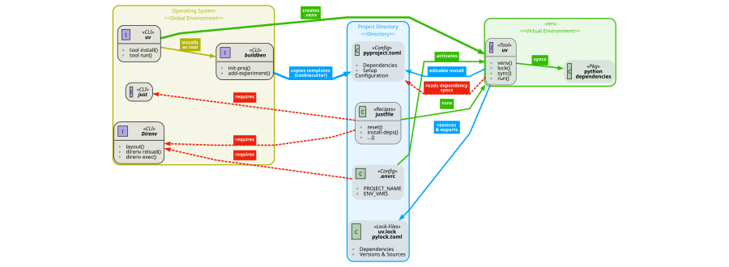

<!-- README EDITING CONTRACT
Adapt this README in place. Preserve its structure, HTML layout, heading levels,
spacing, and useful content. Replace placeholders and update facts within this
design. Before editing, read "README maintenance" in CONTRIBUTING.md.
-->


<!-- ====================================================================== -->
<!-- --- URLs  -->
[`direnv`]: https://direnv.net/
[`just`]: https://github.com/casey/just?tab=readme-ov-file#packages
[`uv`]: https://github.com/astral-sh/uv?tab=readme-ov-file#uv
[`apprc`]: https://pypi.org/project/apprc/


<!-- ====================================================================== -->
<!-- == Header -->
<div align="center">


<!-- --- Title  -->
<a id="project-overview"></a>

# `{my_project}`: A Template


<!-- --- Logo  -->
 <!-- *Part of:*

<a href="https://hisqu.de" target="_blank">
   
</a> 

<br> -->


<!-- --- Badges -->

[](https://github.com/<github_username>/<my_project>/actions/workflows/ci.yml)
[](pyproject.toml)
[](https://www.python.org/downloads/)
[](https://pypi.org/project/<distribution_name>/)


[](https://github.com/astral-sh/uv)
[](https://github.com/astral-sh/ruff)
[](https://microsoft.github.io/pyright/)
[](https://docs.pytest.org/)


</div>


<!-- --- Abstract  -->


A Python command-line application with typed settings and named directories for
persistent data. AppRC supplies configuration commands and a terminal editor.


#### Main dependencies:
<!-- List your main dependencies here and explain why they're important. -->
- **[`apprc`]**: Runtime config, generated `config` CLI, and Textual editor.


<!-- --- Graphical Abstract  -->

<br>

<!-- |  |
|:--:|
| **Fig. 1 - Graphical Abstract:** Buildben creates scaffolds for Python projects adhering to Python PEP standards. |

<br>  -->


<!-- HTML-version of Graphical Abstract -->
<!-- 

<br>

<div align="center">
  
  <p><em> 
  <b> Graphical Abstract: </b> 
  Management of Virtual Environments & Dependencies. Red dashed lines are Dependencies.
  </em></p>
</div> 


 -->


<br>

---


<!-- ====================================================================== -->
### Table of Contents

1. [`{my_project}`: A Template](#project-overview)
2. [Installation](#installation)
   1. [Install a release](#install-a-release)
   2. [Install from a checkout](#install-from-a-checkout)
   3. [Uninstall](#uninstall)
3. [Usage](#usage)
   1. [Use Feature X](#use-feature-x)
   2. [Use Feature Y](#use-feature-y)
4. [Documentation](#documentation)


---

<!-- ====================================================================== -->
<br>

# Installation

The installer uses Python 3.12 or newer through `uv`. If `uv` is not available,
it installs the official user-scoped `uv` executable and lets `uv` provision a
compatible Python; no system Python or administrator access is required.

The managed application environment uses Python 3.13, selected by
`tool.apprc.distribution.runtime-python` in `pyproject.toml`. This is separate
from `project.requires-python`, which describes package-install compatibility
(the scaffold defaults to `>=3.12`). PyApp's bootstrap uses Python 3.14; it does
not determine the Python version used by the installed application.

<br>

## Install a release

The release contains native installers and launchers for Linux and Windows.
Download the exact release inventory, including its manifest, before running
the platform installer:

```shell
gh release download vX.Y.Z --repo <github_username>/<my_project>
./<my_project>-install-linux-x86_64
```

On Windows, run `<my_project>-install-windows-x86_64.exe`. Windows native
runtime validation remains deferred; do not treat cross-compilation as runtime
proof.

With no selector, a downloaded native entry installs the exact authenticated
runtime embedded in that release; it does not move to the latest release.
`--version X.Y.Z` selects a published release, and `--main` resolves the
repository's current `main` to one immutable commit for that invocation. These
choices cannot be combined. `--github-client gh` selects authenticated GitHub
CLI downloads; public downloads do not inherit GitHub CLI credentials.

From a source checkout, generate its ordinary Python artifacts with
`just make-artifacts`, then run `python app-install.py` and `python
app-launch.py`. These commands use the checkout root recorded by the SDK,
independent of the caller's working directory. `just check-artifacts` verifies
tracked outputs without invoking Rust or rewriting files. Native compilation
is a separate release-authoring operation.

The installer offers native or single-root resource placement when the
application declares resource capabilities. Use `--layout native` for native
locations or `--layout single-root --root ABSOLUTE_PATH` for a single root.
Reinstallation keeps the saved absolute placement unless an explicit layout
override is supplied. Buildben itself declares no application data paths.

Configuration setup is optional and does not block installation management.

<br>

## Install from a checkout

Clone the repository, synchronize its locked authoring environment, and
generate local AppRC artifacts before running the checkout installer:

```shell
git clone https://github.com/<github_username>/<my_project>.git
cd <my_project>
uv sync --locked --all-extras --all-groups
just make-artifacts
```

Run the generated developer entries from the checkout:

```shell
python app-install.py --layout native
python app-launch.py
```

The checkout install is editable and uses the actual project files, including
uncommitted changes. It does not alter the repository's saved source revision.
Use `just check-artifacts` to check generated outputs without rewriting them.

<br>

## Uninstall

Run `./app-uninstall.sh` on Linux or macOS, or `.\app-uninstall.cmd` on Windows.
The default removes the managed program and retains declared resources and
installation recovery support. Complete removal requires an explicit request:

```shell
./app-uninstall.sh --complete --category config --category appdata --yes
```

Use the same options with `app-uninstall.cmd` on Windows. Only select resource
categories that the application declared; unknown files and external data are
not inferred as cleanup targets. The saved uninstall code invokes any
repository-owned cleanup before removing the installed program. Inspection and
recovery use `{my_project} installation show`, `{my_project} installation
doctor`, and `{my_project} installation repair`.

The saved controller is stored under the fixed native `installation/` address,
separate from application data. Repeated commands do not redirect it when the
shell's `HOME`, XDG variables, or `LOCALAPPDATA` change.

<br>


<!-- ====================================================================== -->
<br>


# Usage

The installed command and AppRC management remain available before business
setup. Run these commands from the installed application environment:

```shell
{my_project} version
{my_project} diagnose --json
{my_project} installation show
{my_project} config show --json
{my_project} launcher
```

Application resources use the paths declared by `APP_RC`. Config, appdata,
cache, and state are independent capabilities; disabled paths stay absent and
installation management does not enable them. The `installation/` authority is
separate from application data. See the
[filesystem capabilities](docs/Explanations.md#filesystem-capabilities) and
[installation placement reference](docs/References.md#installation-placement).


<br>

## Use Feature X

<!-- Explain core feature after setup -->

lorem ipsum dolor


<br>

## Use Feature Y

<!-- Explain core feature after setup -->

lorem ipsum


<!-- ====================================================================== -->
<br>

# Documentation

### Using the Project
- [Documentation](docs/README.md) — Start here and find the right guide.
- [How-to user guides](docs/How-To-User-Guides.md) — Complete specific tasks.
- [Examples](docs/EXAMPLES.md) — Follow complete, working examples.
- [Explanations](docs/Explanations.md) — Understand the components and their connections.
- [References](docs/References.md) — Look up commands, settings, and APIs.

### Contributing and Maintaining
- [Contributing](CONTRIBUTING.md) — Propose changes and prepare a contribution.
- [Development](docs/Development.md) — Work on the code and maintain the project.
  - [Development environment](docs/Development.md#maintainer-environment)
  - [Repository layout](docs/Development.md#repository-routing)
  - [Documentation authoring](docs/Development.md#documentation-authoring)
  - [Verification](docs/Development.md#verification)
  - [Windows installer verification](docs/Development.md#windows-installer-verification-procedure)
  - [Unix installer staging verification](docs/Development.md#unix-installer-staging-verification)
  - [Releases](docs/Development.md#releases)

